

 <h1> Sprint 0 </h1> 

<h3> Maandag Kickoff: </h3>

Tijdens de kickoff hebben we uitleg gekregen over wat dit blok inhoudt, wat we gaan doen en wat we de komende weken kunnen verwachten. In dit blok gaan we onze eigen Digital Garden maken en deze steeds verder ontwikkelen door de kennis die we tijdens de lessen opdoen toe te passen. Verder hebben we een HWIVI zelftest gemaakt om onze kennis van de afgelopen blokken van vorig jaar op te frissen. Uit deze test bleek dat ik nog best veel termen herkende en had onthouden. Hier was ik positief over, omdat ik van tevoren niet wist hoeveel ik nog zou weten. In de middag hebben we een GitHub account aangemaakt, Visual Studio Code geïnstalleerd en een eigen domeinnaam aangeschaft via TransIP. Ik heb ervoor gekozen om mijn website naya404.nl te noemen. Vervolgens hebben we de dag afgesloten met een aantal check outvragen.

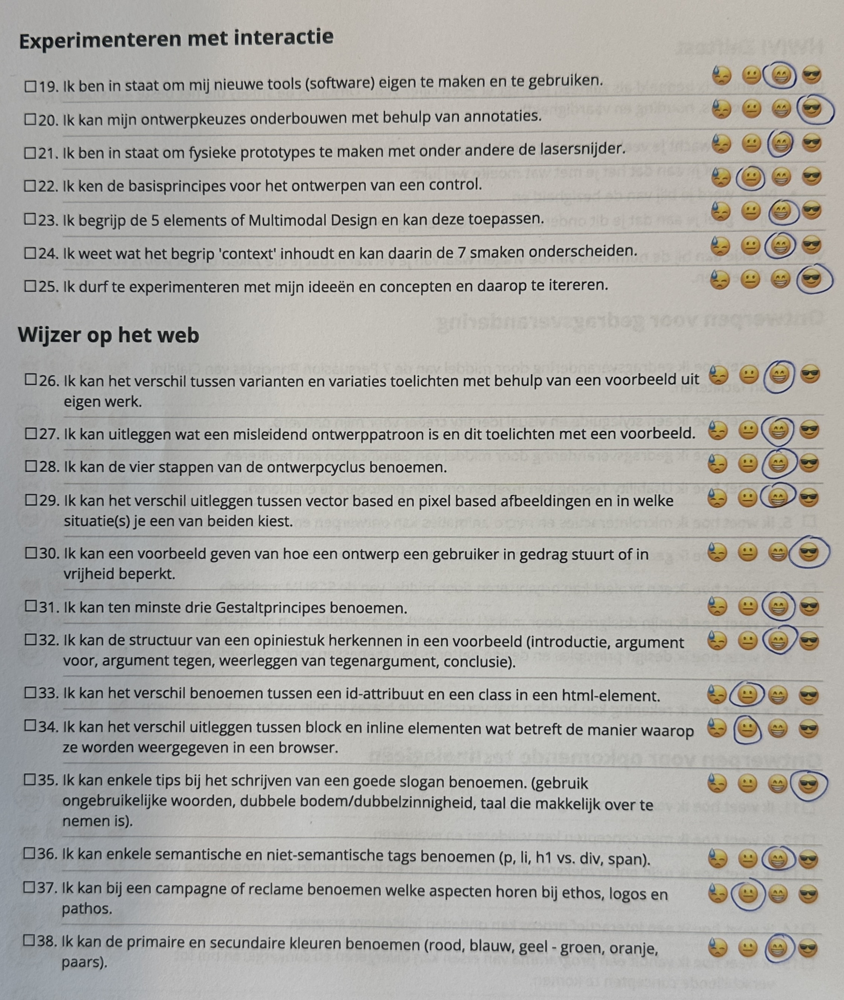

<strong> Check outvragen: </strong>

1. Leg uit wat een source hosting platform is en voor welke jij gekozen hebt?
   Een source hosting platform is een online platform waarop je je code en bestanden kunt opslaan, beheren en bijhouden. Je kunt ook terugzien welke aanpassingen je hebt gemaakt en eventueel teruggaan naar een eerdere versie van je code. Ik heb gekozen voor GitHub. Hier ga ik de code van mijn Digital Garden opslaan en mijn logboek bijhouden.
2. Vertel welke domeinnaam jij gekozen hebt en hoe je die hebt gekoppeld aan jouw pagina?
   Ik heb gekozen voor de domeinnaam naya404.nl. Deze heb ik aangeschaft via TransIP. Door de DNS instellingen van mijn domeinnaam aan te passen en mijn domeinnaam te koppelen aan GitHub Pages, kan mijn website via mijn eigen domeinnaam bezocht worden.
3. Beschrijf hoe je aanpassingen aan jouw pagina kunt maken en hoe je ervoor zorgt dat die op het web gepubliceerd worden?
   Ik kan aanpassingen aan mijn website maken in Visual Studio Code. Met HTML kan ik de structuur en de content van mijn website bepalen en met CSS kan ik mijn website de gewenste stijl geven, zoals kleuren, lettertypes en de indeling. Wanneer ik een aanpassing heb gemaakt, sla ik deze op en zet ik de wijzigingen door naar GitHub door middel van een commit en een push. Via GitHub Pages worden de wijzigingen vervolgens gepubliceerd op mijn eigen website.

<h3>Woensdag 11/11: </h3>

 <strong>Interactie </strong> 

Deep Dive Interactie (MMD, micro interacties en forms)
Tijdens deze Deep Dive heb ik mijn kennis over Multi Modal Design (MMD) opgefrist. Hierbij zijn de vijf principes affordance, feedback, feedforward, cue en prompt aan bod gekomen. Verder heb ik geleerd hoe kleine interacties, zoals hover effecten, kleurveranderingen en animaties, de gebruiker kunnen helpen tijdens het navigeren op een website. Vervolgens kregen we de opdracht om de fysieke menukaart van Wok to Walk te vertalen naar een bruikbaar online formulier. Hiervoor heb ik twee verschillende schetsen gemaakt. Bij mijn eerste schets heb ik het bestelproces verdeeld in drie stappen: het kiezen van een basis, toppings en saus. Hierbij heb ik gebruikgemaakt van tabs, swipe interacties, dropdownmenu's en primary buttons. Bij mijn tweede schets heb ik geprobeerd om alle stappen op een scherm te verwerken. Wat ik vooral uit deze opdracht heb meegenomen, is dat ik niet alleen moet nadenken over hoe iets er visueel uitziet, maar ook over hoe de gebruiker ermee omgaat. Bijvoorbeeld door een geselecteerde optie een andere kleur te geven (feedback) of door met cijfers aan te geven bij welke stap de gebruiker is (cue). Deze kennis wil ik ook meenemen tijdens het ontwerpen van mijn eigen Digital Garden, door kleine interacties toe te voegen die niet alleen leuk zijn, maar ook daadwerkelijk een functie hebben.

 <strong> Practicum animatie </strong> 

Tijdens deze les hebben we uitleg gekregen over verschillende manieren van schetsen. We zijn begonnen met de basis, waarbij we hebben geoefend met het tekenen van rechte lijnen, vierkanten in verschillende groottes en telefoons op ware grootte. Verder hebben we het verschil tussen low-fi, mi-fi en hi-fi schetsen behandeld. Wat ik hierbij heb geleerd, is hoe ik door middel van verschillende lijndiktes, schaduwen en accenten bepaalde elementen meer kan laten opvallen in mijn schetsen. Vervolgens kregen we de opdracht om een mi-fi schets te maken van een website die we vaak gebruiken. Ik heb hiervoor gekozen voor Bol.Com. Tijdens het schetsen heb ik geprobeerd om de technieken die we eerder in de les hebben behandeld toe te passen. Verder hebben we uitleg gekregen over hoe we animaties en interacties op papier kunnen weergeven door gebruik te maken van pijlen, stippellijnen en annotaties. Wat ik vooral uit deze les heb meegenomen, is dat een schets niet altijd perfect hoeft te zijn en dat ik niet meteen bezig hoef te zijn met alle kleine details. Het belangrijkste is dat mijn idee duidelijk overkomt. Deze technieken kan ik straks ook toepassen bij het schetsen van mijn eigen Digital Garden.

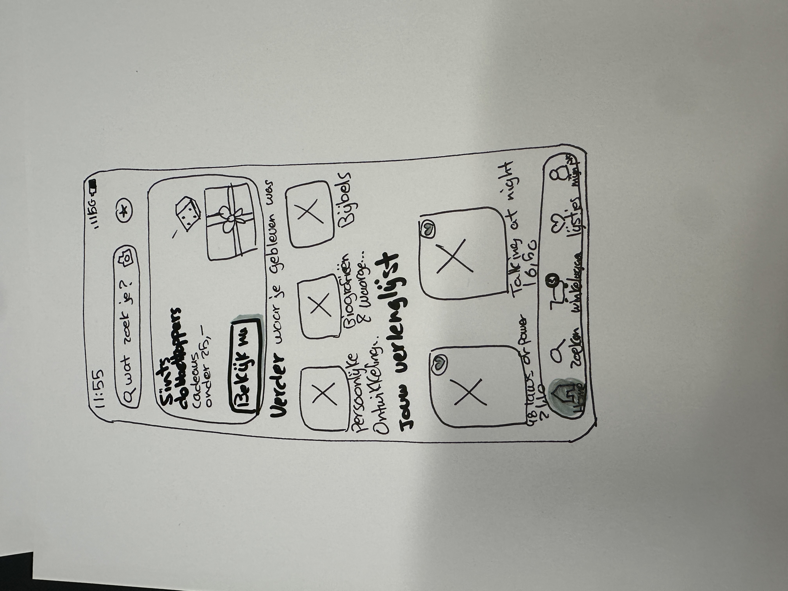
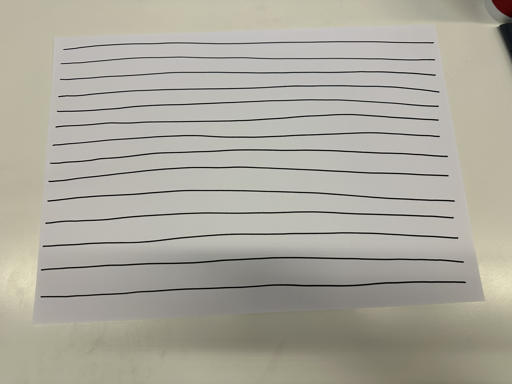
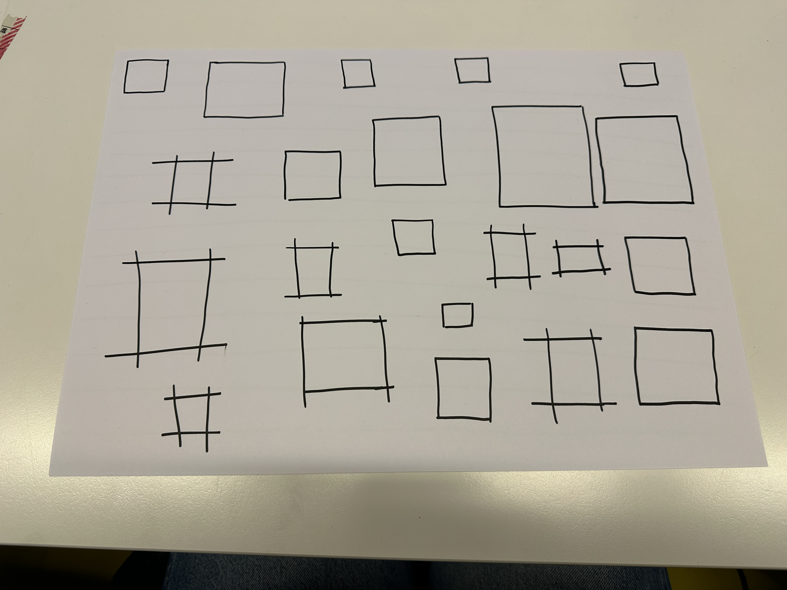
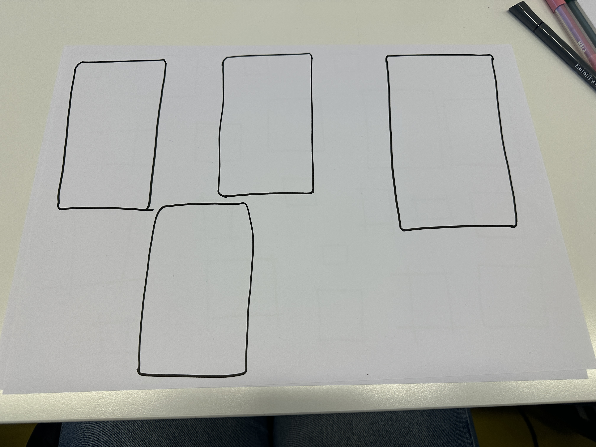

<h3>Vrijdag 13/11: </h3>

 <strong>Practicum CSS </strong> 

Helaas kon ik deze les niet bijwonen omdat ik ziek was. Ik heb daarom dezelfde dag thuis de lesstof doorgenomen en de oefeningen ingehaald.
Zelf vind ik coderen best leuk om te doen. Op de middelbare school heb ik ook informatica gevolgd, waardoor ik al wat basiskennis heb. Wel merk ik dat ik sommige dingen ben vergeten, dus deze oefeningen waren voor mij ook een goede opfrisser. Wat voor mij nieuw was, is het gebruik van custom properties. Ik vind het vooral handig dat je bijvoorbeeld een kleur of witruimte maar op een plek hoeft aan te passen in plaats van overal in je code. Verder heb ik meer geleerd over hover en focus states en hoe ik hiermee mijn website toegankelijker kan maken. Wat ik zelf leuk vind aan CSS is dat je direct resultaat ziet van wat je aanpast. Ik kijk er dan ook naar uit om hier meer mee te experimenteren binnen mijn eigen Digital Garden.

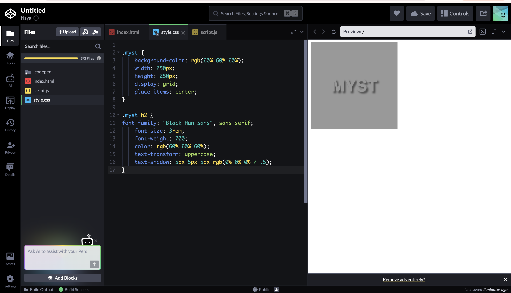

 <strong>Practicum CSS fonts </strong> 

Tijdens deze opdracht heb ik de kennis uit de lessen toegepast door een mini poster na te maken met CSS. Een aantal codes, zoals font-family, font-size en background-color, waren voor mij al bekend. Wat voor mij wel nieuw was, was het gebruik van text shadow. Ik wist namelijk niet dat je met dezelfde kleur voor de tekst en de achtergrond alsnog een diepte effect kon creëren door alleen schaduw toe te voegen. Verder heb ik geleerd dat ik met tekst transform mijn tekst in hoofdletters kan weergeven zonder iets in mijn HTML te hoeven veranderen. Ik vond dit persoonlijk een leuke opdracht, omdat ik zowel visueel ontwerpen als coderen interessant vind. Normaal gesproken zou ik zulke effecten eerder in figma of Illustrator maken, maar ik vind het juist leuk om te ontdekken dat dit ook mogelijk is met een paar regels CSS. Dit zijn ook technieken waarmee ik verder wil experimenteren binnen mijn eigen Digital Garden.

 <h1> Sprint 1</h1> 

 <h2>  Week 1 </h2> 

<h3> Maandag 16/11 </h3>

 <strong> Opdracht 1: Rangschikken </strong> 

Tijdens deze les zijn we begonnen met het bekijken en analyseren van bestaande websites om inspiratie op te doen voor onze eigen Digital Garden. Ik heb twee websites geanalyseerd, namelijk annaecook.com en mikemai.net. Hierbij heb ik gekeken naar hoe webby de websites zijn op basis van toegankelijkheid, interactie, expressiviteit, adaptiviteit en originaliteit. Persoonlijk sprak de website van Anna mij meer aan. Ondanks dat de website vrij simpel is, heeft het wel een eigen uitstraling. Er wordt veel gespeeld met hover effecten en animaties, zonder dat de website onoverzichtelijk wordt. De website van Mike Mai vond ik daarentegen minder interessant, omdat ik weinig interacties zag en de visuele hiërarchie voor mij niet duidelijk genoeg was. Wat ik vooral uit deze opdracht heb meegenomen, is dat een mooie website niet automatisch een goede website is. Ik moet ook rekening houden met hoe de website werkt op verschillende schermformaten, hoe toegankelijk deze is en hoe de gebruiker ermee kan omgaan. Voor mijn eigen Digital Garden wil ik juist experimenteren met kleuren, typografie, animaties en kleine interacties. Ik vind het belangrijk dat mijn website een eigen uitstraling krijgt die bij mij past, maar tegelijkertijd ook duidelijk en gebruiksvriendelijk blijft.

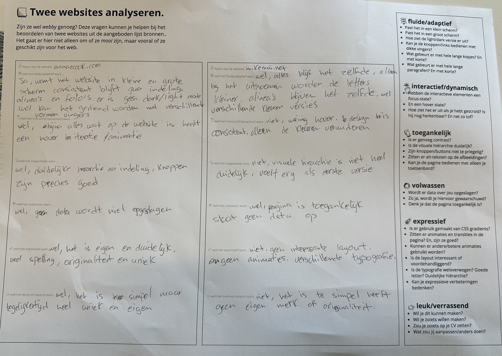

 <strong> Opdracht 2: Eigen verkenning </strong> 

Wat wil ik zelf maken?

Ik wil een Digital Garden maken die echt bij mij past. Tijdens het bekijken van de verschillende websites merkte ik dat ik vooral hou van websites die simpel zijn, maar tegelijkertijd iets unieks hebben. Ik wil zelf iets maken dat overzichtelijk is, maar zeker niet saai. Een website waar je als bezoeker dingen kan ontdekken.

Welke webby dingen wil ik gebruiken?
• Hover-effecten bij knoppen, teksten en afbeeldingen.
• Animaties tijdens het scrollen.
• Experimenteren met kleuren, gradients en typografie.
• Light en dark mode.
• Een interessante en tegelijkertijd duidelijke layout.

Eigen content, toon en doel:
Ik wil mijn Digital Garden persoonlijk en creatief maken. Niet te serieus of formeel, maar juist op een manier die bij mij past. Ik ben zelf graag creatief bezig en wil daarom mijn interesses, ideeën, inspiratie en dingen die ik zelf maak hierin laten terugkomen. Mijn doel is om een eigen online ruimte te creëren waarin ik mijn creativiteit kwijt kan, maar waar anderen eventueel ook inspiratie uit kunnen halen.

Content van anderen
Ik wil zoveel mogelijk gebruikmaken van mijn eigen content, zoals foto's, teksten en ontwerpen. Natuurlijk wil ik ook inspiratie halen uit andere websites en ontwerpen. Als ik content van iemand anders gebruik, wil ik eerst kijken of ik deze mag gebruiken en de bron erbij vermelden. Ik wil niet zomaar iets overnemen, maar juist kijken hoe ik er mijn eigen draai aan kan geven.

Verschillende ervaringen

Ik wil niet dat mijn website alleen bestaat uit teksten en afbeeldingen. Het lijkt mij juist leuk om verschillende ervaringen te creëren.
Zien: door het gebruik van kleuren, afbeeldingen, typografie en animaties.
Voelen: door de sfeer en uitstraling die ik met mijn website wil overbrengen.
Beleven: door interactieve elementen waar de bezoeker op kan klikken of mee kan spelen.
Ik wil vooral dat mensen nieuwsgierig worden tijdens het bezoeken van mijn website en uit zichzelf verder willen kijken.

 <strong> Verdere verkenning van mijn Digital Garden: </strong> 

My Digital World
Een introductie van mijn onderwerp, mijn interesses en waarom ik hiervoor heb gekozen.
My Inspiration
Het verzamelen van 50 afbeeldingen die mij aanspreken en inspireren, verdeeld in verschillende categorieën.
My Aesthetic
Het onderzoeken van verschillende kleuren, vormen, stijlen en symboliek die bij mij passen en die ik eventueel wil verwerken in mijn ontwerp.
My Research
Het beantwoorden van de vijf onderzoeksvragen om meer inzicht te krijgen in mijn onderwerp en de richting die ik op wil gaan.
Web Inspiration
Het verzamelen van websites met interessante layouts, animaties en interacties die ik zelf nog niet kan maken, maar wel graag zou willen leren.
My Direction
Op basis van mijn onderzoek en verzamelde inspiratie bepalen wat ik uiteindelijk wil maken. Ik wil mezelf hierin nog niet te veel beperken, omdat ik juist tijdens dit blok nieuwe dingen wil ontdekken, uitproberen en leren.

<strong> De checkout vragen voor vandaag: </strong>

1. Leg uit wat een Digital Garden is en waarom dat anders is dan een reguliere website?

Een Digital Garden is eigenlijk een eigen stukje op het web waar je als maker jouw gedachten, ideeën, interesses en inspiratie kwijt kan. Het is een eigen online ruimte die je helemaal naar jouw smaak kan inrichten en waarin je vrij bent om te experimenteren. Wat het anders maakt dan een reguliere website, is dat een Digital Garden nooit echt af hoeft te zijn. Je kan deze steeds verder ontwikkelen en nieuwe dingen blijven toevoegen. 2. Leg uit wat een website 'webby' maakt en welke websites jou het meeste inspireren.
Voor mij is een website webby wanneer er echt gebruik wordt gemaakt van de mogelijkheden die het web biedt. Denk hierbij aan animaties, interacties, gradients, hover-effecten en het aanpassen aan verschillende schermformaten?

De website van Anna E. Cook inspireerde mij het meest, omdat zij ondanks een simpele indeling toch een unieke en persoonlijke stijl heeft weten te creëren. Dat is ook iets wat ik zelf wil bereiken met mijn Digital Garden. 3. Vertel waar jij mee aan de slag wilt gaan bij het maken van jouw eigen Digital Garden?

Mijn eerste idee is om een persoonlijk portfolio te maken in de stijl van een boek. Ik vind het interessant om te onderzoeken hoe ik de ervaring van een fysiek boek kan vertalen naar het web. Bijvoorbeeld door animaties toe te voegen waarmee je digitaal door de pagina's kan bladeren.
Ik wil hier mijn eigen interesses, creativiteit en persoonlijke stijl in verwerken. Dit is voor nu mijn eerste idee, maar ik sta er ook voor open om tijdens het blok een andere richting op te gaan als ik iets tegenkom wat mij meer aanspreekt.

<strong> Crazy 8</strong>

Mijn eerste idee voor mijn Digital Garden was om een persoonlijk portfolio te maken in de stijl van een boek. Uiteindelijk heb ik ervoor gekozen om een andere richting op te gaan en mijn website te richten op een van mijn grootste hobby's, namelijk het maken van kaarsen. Ik wil geen webshop maken, maar een online showroom waar ik mijn zelfgemaakte kaarsen kan presenteren en meer kan vertellen over mijn collecties, geuren en ingrediënten. Door middel van de Crazy 8 methode heb ik acht verschillende ideeën geschetst. Hierbij heb ik vooral gekeken naar verschillende indelingen, hoe ik mijn foto's wil presenteren en welke leuke interacties ik kan toevoegen. Wat mij persoonlijk het meeste aanspreekt, is het idee om een kaars aan en uit te kunnen zetten. Hiermee wil ik de light en dark mode op een creatieve manier verwerken die ook echt bij mijn onderwerp past. Door deze schetsen te maken heb ik een beter beeld gekregen van hoe ik mijn showroom wil vormgeven en welke ideeën ik verder wil uitwerken.

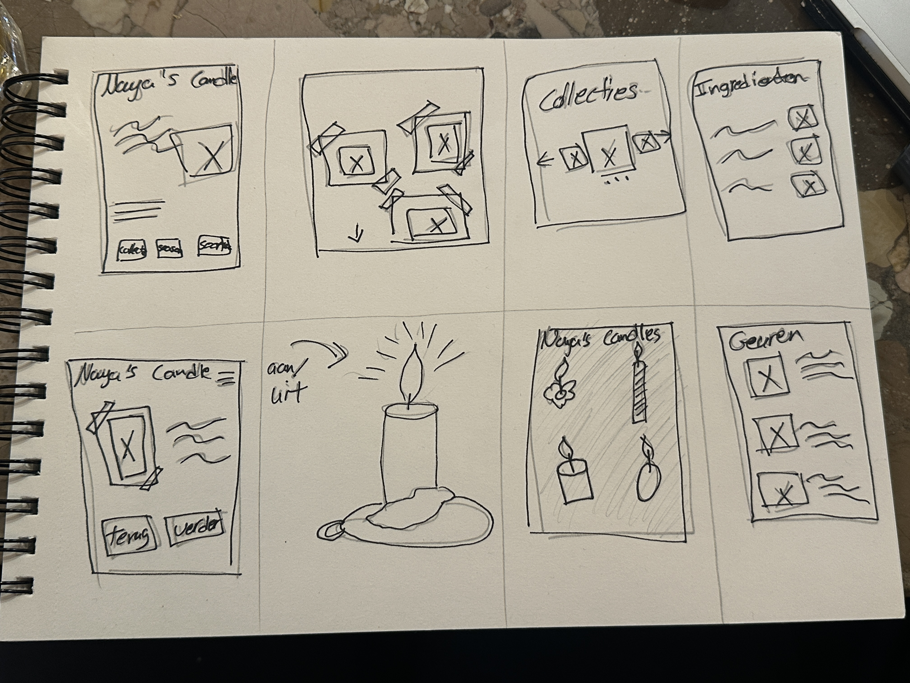

<strong>Schermen schetsen</strong>

Na het maken van de Crazy 8 ben ik verder gaan schetsen met de ideeën die mij het meeste aanspraken. Ik heb verschillende indelingen gemaakt om te kijken hoe ik mijn kaarsen het beste kan presenteren in mijn showroom. Ik heb ervoor gekozen om mijn kaarsen te verdelen in verschillende collecties, namelijk Ramadan, Kerst, Pasen en bloemen. Daarnaast wil ik een gedeelte waarin ik meer vertel over Naya's Candle en het maakproces van mijn kaarsen. Tijdens het schetsen heb ik ook de kennis uit de voorgaande lessen toegepast. Zo heb ik met verschillende kleuren aangegeven welke elementen klikbaar zijn, waar ik hover-effecten wil toevoegen en wat de knoppen zijn. Ook heb ik het idee van de kaars die je aan en uit kan zetten verder verwerkt in mijn navigatie. Ik heb voor nu nog niet te veel aandacht besteed aan de details en kleuren, omdat ik eerst tevreden wil zijn met de indeling voordat ik verder ga met de visuele uitwerking.

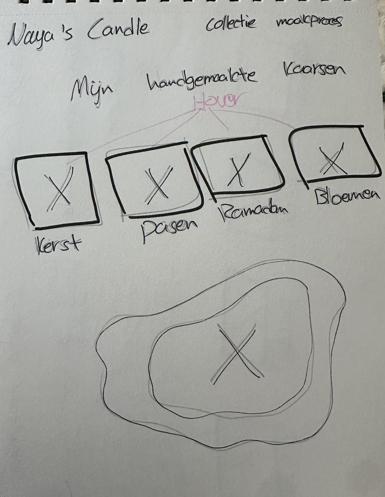
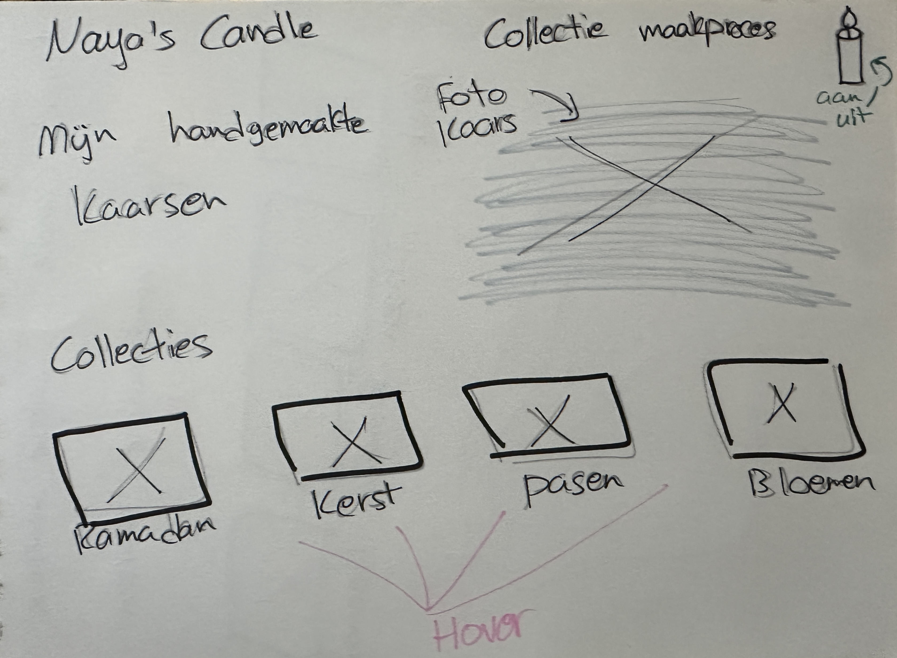
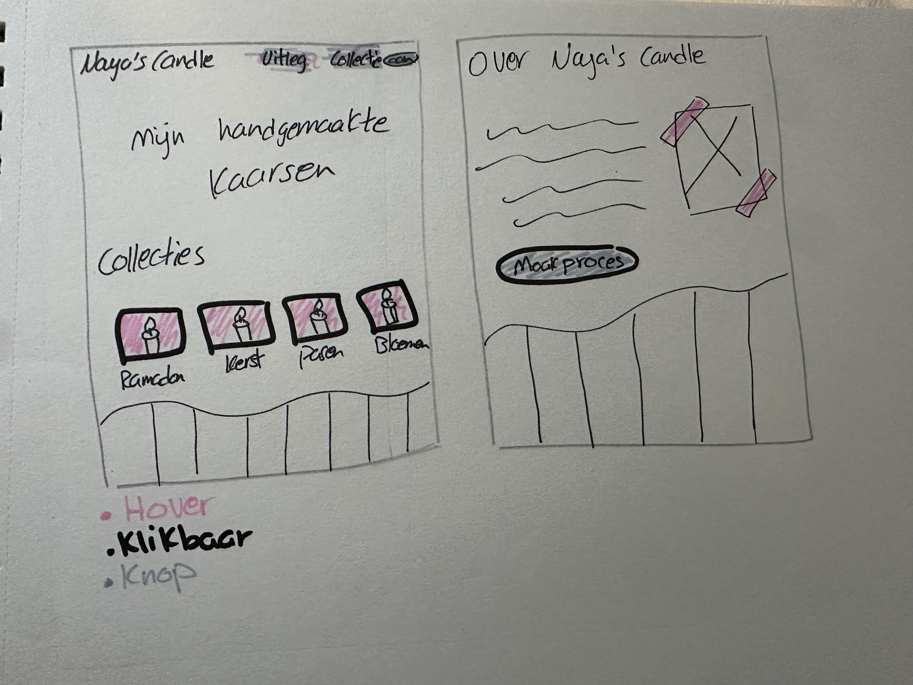

<strong>Styleguide </strong>

Voordat ik verder ben gegaan met coderen, heb ik een styleguide gemaakt om een duidelijk beeld te krijgen van de uitstraling van mijn showroom. Ik heb twee kleurenpaletten samengesteld, één voor de light mode en één voor de dark mode. Ik heb gekozen voor crème en donkerbruin als basiskleuren en roze, geel en groen als accentkleuren. Ik wil namelijk een warme uitstraling creëren, maar tegelijkertijd ook wat speelsheid toevoegen door middel van opvallende kleuren. Voor de typografie heb ik gekozen voor Playfair in Regular en Bold. Ik vind dit lettertype goed passen bij de uitstraling die ik met mijn kaarsen wil overbrengen. Verder heb ik mijn eigen foto's gebruikt voor de beeldtaal en nagedacht over de vormgeving van mijn knoppen en mogelijke animaties, zoals hover-effecten, fade-in en een candle glow-effect. Ook heb ik mijn idee om een kaars als light en dark mode-knop te gebruiken hierin verwerkt. Tijdens het coderen wil ik deze styleguide als uitgangspunt gebruiken, zodat ik consistent blijf in mijn ontwerp. Natuurlijk kunnen er nog dingen veranderen tijdens het coderen, omdat ik ook wil experimenteren met de mogelijkheden van CSS.

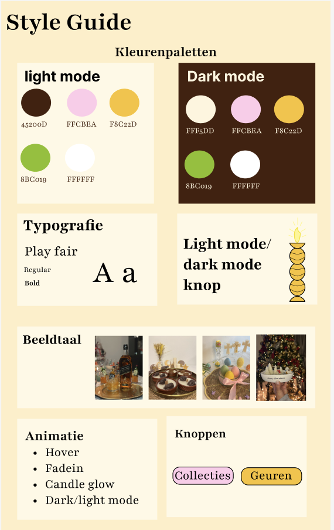

 <h2>  Week 2 </h2> 

<strong>Coderen </strong>

Na het maken van mijn schetsen ben ik in week 2 begonnen met het coderen van mijn website in Visual Studio Code. Ik heb hierbij mijn schetsen als uitgangspunt gebruikt en geprobeerd om zoveel mogelijk de kennis uit de voorgaande lessen toe te passen. Ik ben begonnen met het opzetten van de structuur in HTML en vervolgens ben ik met CSS aan de slag gegaan om mijn website de gewenste uitstraling te geven. Hierbij heb ik geëxperimenteerd met kleuren, lettertypes, afbeeldingen, gradients en hover effecten. Verder ben ik aan de slag gegaan met het responsive maken van mijn website en het verwerken van light en dark mode. Ik wil hierbij het idee van het aan- en uitzetten van een kaars behouden. Ik merk dat ik coderen steeds leuker begin te vinden, vooral omdat ik nu bezig ben met iets wat ik zelf heb bedacht en ontworpen. Ik probeer mijn codes zo simpel mogelijk te houden, zodat ik ook zelf begrijp wat ik aan het doen ben en later makkelijk aanpassingen kan maken.Tijdens het coderen merk ik ook dat niet alles wat ik heb geschetst even makkelijk te realiseren is. Hierdoor blijf ik experimenteren en pas ik tussendoor mijn ontwerp aan.

 

 

